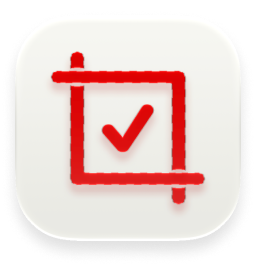
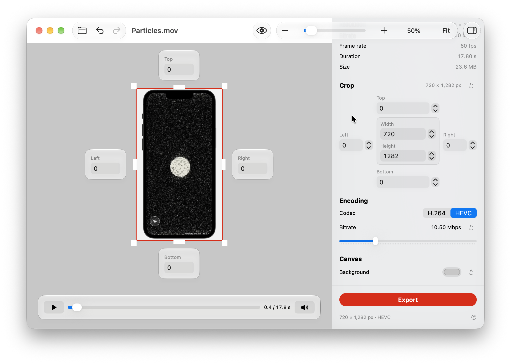

  

# Good Frame

Good Frame is a **Mac app** that lets you crop a video or image precisely in a **zoomable canvas**.

## Screenshot

## Install

Requires macOS 15.6 or later.

1. Download or clone this repository.
2. Open `GoodFrame.xcodeproj` in Xcode.
3. Build and run on Mac.
4. To keep the app in Applications, go to **Product → Show Build Folder in Finder**, open **Products → Debug**, and copy **Good Frame.app** into **Applications**.

## Features

Visit [**poshtinkering.com/good-frame**](https://www.poshtinkering.com/good-frame).
