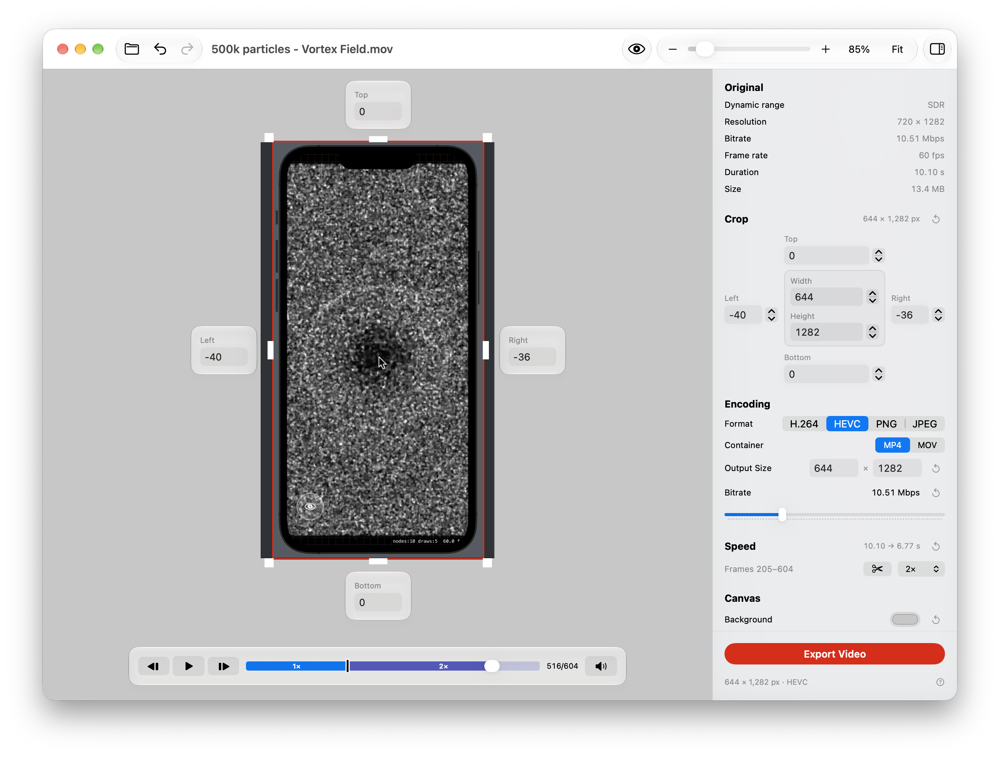

  

# Good Frame

Good Frame is a **Mac app** for cropping, resizing, speeding, and encoding videos and images with **precision**.

## Install

Requires macOS 15.6 or later.

**Download:** get the app from [**achrafkassioui.com/good-frame**](https://www.achrafkassioui.com/good-frame).

**Build from source:** with Xcode installed, download or clone this repository and double-click `Install.command`. It builds Good Frame and puts it in the Applications folder.

## Demo & Features

Visit [**achrafkassioui.com/good-frame**](https://www.achrafkassioui.com/good-frame).

## Change Log

### 1.7.1

- Export still works after the original file is renamed, moved, or put in the Trash. If the file was permanently deleted, exporting doesn't start and a message says so.

### 1.7

- Cut a section in a video with the `Skip` option. Skipped sections don't play or export.
- When a keyframe is dragged, the playhead follows it. Turn it off in the Speed menu.
- UI performance improvements.

### 1.6

- Improved UI for speed change.
- Loop playback (⌥⌘L).

### 1.5

- Speed up parts of a video. Split the timeline at any frame and set each section's speed. Audio keeps its pitch.
- Set the output size in pixels, maintaining the crop proportions.
- Export videos as MP4 or MOV.
- New Speed menu. Play and pause with Space.
- Confirmation before quitting during an export.
- New `Install.command` script.

### 1.4

- Extend the frame of videos and images to add space around them.

### 1.3

- Paste video or image into an empty app window.

### 1.2

- Step through videos frame by frame.
- Export the current video frame as PNG or JPEG, with HDR support.
- Copy images directly from the export window.
- Drag exported files using the proxy icon (title bar file icon).
- Open a new app window fron the Dock menu.
- UI Improvements and new keyboard shortcuts.

### 1.1

- Export windows open centered over the app window that started the export.
